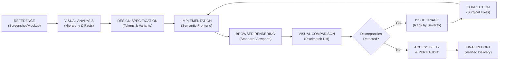

# Visual Engineering Suite

[](#automated-testing)
[](https://skills.sh)
[](https://antigravity.google)
[](./LICENSE)

A production-quality, open-source, cross-agent visual engineering skill suite for AI coding agents (Google Antigravity, Claude Code, Cursor, and Agent Skills-compatible platforms).

---

## 1. The Problem Being Solved

When AI coding assistants are asked to *"implement this screenshot"* or *"build this UI"*, they typically produce superficial code:
- Guessing arbitrary padding, font sizes, and colors rather than extracting design tokens.
- Ignoring existing codebase conventions, duplicate CSS classes, and established design systems.
- Declaring victory without ever verifying the rendered browser output or testing viewport behavior.
- Missing responsive overflow failures, broken focus rings, and accessibility violations.

The **Visual Engineering Suite** replaces blind one-shot generation with a systematic, closed-loop engineering workflow:



---

## 2. Key Differences from Generic Prompting

| Dimension | Generic Frontend Prompt | Visual Engineering Suite |
| :--- | :--- | :--- |
| **Observation** | Conflates guesses with visual facts | Formally separates empirical observations from hypotheses and logs uncertainty |
| **Tokens** | Introduces arbitrary inline hex codes and magic margins | Discovers and reuses existing Tailwind configs, CSS variables, or project theme tokens |
| **Verification** | Assumes the code matches because it compiled | Renders in real browser and measures pixel discrepancy against reference mockups |
| **Regression Triage** | Vague feedback ("Make it look cleaner") | Exact coordinate bounding box `[minX..maxX, minY..maxY]`, diff percentage, and severity triage |
| **Portability** | Hardcoded to one proprietary chat window | Standardized `SKILL.md` format installable across Antigravity, Claude Code, and Cursor |

---

## 3. The 6 Specialist Skills

The suite organizes visual engineering into six focused, single-responsibility skills:

### 1. `visual-reconstruction`
- **When to activate**: When provided a mockup, screenshot, or URL that needs to be reconstructed into code.
- **Responsibilities**: Inspects reference dimensions, decomposes spatial hierarchy, establishes typography ladders, separates facts from assumptions, and produces a structured UI specification before coding begins.
- **Artifacts**: [reconstruction-schema.json](./skills/visual-reconstruction/references/reconstruction-schema.json), [visual-analysis-guide.md](./skills/visual-reconstruction/references/visual-analysis-guide.md).

### 2. `design-system-extraction`
- **When to activate**: When establishing or harmonizing design tokens for colors, spacing, typography, radii, and shadows.
- **Responsibilities**: Inspects the host repository for existing Tailwind or CSS custom properties, prevents token sprawl, and maps candidate colors to project conventions.
- **Artifacts**: [token-schema.json](./skills/design-system-extraction/references/token-schema.json), [token-mapping-guide.md](./skills/design-system-extraction/references/token-mapping-guide.md).

### 3. `frontend-implementation`
- **When to activate**: When writing or updating component code in the host codebase.
- **Responsibilities**: Follows framework conventions (React, Next.js, Vue, Svelte), enforces semantic HTML, handles the full state matrix (loading, empty, error, active, focus-visible), and preserves existing architecture without unrelated rewrites.
- **Artifacts**: [state-matrix-template.md](./skills/frontend-implementation/references/state-matrix-template.md), [framework-adaptation-guide.md](./skills/frontend-implementation/references/framework-adaptation-guide.md).

### 4. `browser-visual-qa`
- **When to activate**: When rendering implemented components in a browser environment to capture screenshots and monitor runtime behavior.
- **Responsibilities**: Detects native agent browser tools or invokes the Playwright capture runner, captures standard viewports (`mobile`, `tablet`, `desktop`, `wide`), and inspects console errors and failed network requests.
- **Artifacts**: [viewport-standards.md](./skills/browser-visual-qa/references/viewport-standards.md).

### 5. `visual-regression-triage`
- **When to activate**: When comparing reference mockups against candidate browser captures.
- **Responsibilities**: Asserts identical viewport dimensions, executes pixel-level visual diffing via `pixelmatch`, computes mismatch counts and discrepancy bounding boxes, filters out antialiasing noise, and prioritizes fixes by severity.
- **Artifacts**: [triage-taxonomy.md](./skills/visual-regression-triage/references/triage-taxonomy.md).

### 6. `accessibility-performance-audit`
- **When to activate**: When verifying compliance with accessibility standards and responsive reflow rules.
- **Responsibilities**: Scans for missing `alt` attributes, unlabelled buttons, and removed focus outlines; verifies WCAG 2.1 AA color contrast (≥4.5:1); checks touch targets (≥44x44px); and tests reflow down to 320px.
- **Artifacts**: [wcag-checklist.md](./skills/accessibility-performance-audit/references/wcag-checklist.md), [responsive-reflow-guide.md](./skills/accessibility-performance-audit/references/responsive-reflow-guide.md).

---

## 4. Multi-Agent Compatibility Matrix

| Platform | Project Installation Path | Global Installation Path | Native Support | Verification Status |
| :--- | :--- | :--- | :--- | :--- |
| **Google Antigravity** | `.agents/skills/<name>/` | `~/.gemini/antigravity/skills/` | Native Plugin (`plugin.json`) | **Verified** |
| **Claude Code** | `.claude/skills/<name>/` | `~/.claude/skills/` | Agent Skills format (`SKILL.md`) | **Verified** |
| **Cursor** | `.agents/skills/<name>/` | `~/.cursor/skills/` | Open `.agents` standard | **Verified** |
| **Vercel Skills CLI** | Dynamic via `skills add` | Dynamic via `skills add -g` | Open Agent Skills spec | **Verified** |

---

## 5. Installation

### Method A: Vercel Skills CLI (Recommended for Multi-Agent Projects)
Install skills directly into all supported agents using the official Skills CLI:

```bash
# Install to Claude Code, Cursor, and Antigravity simultaneously
npx skills add <OWNER>/visual-engineering-suite -a claude-code -a cursor -a antigravity -y

# Or install to all detected agents
npx skills add <OWNER>/visual-engineering-suite --all -y
```

### Method B: Native Google Antigravity Plugin
This repository is packaged as a ready-to-run Antigravity plugin with a root `plugin.json` and `rules/AGENTS.md`.

- **Workspace Scope**: Place or submodule the repository at `.agents/plugins/visual-engineering-suite/` in your project root.
- **Global Scope**: Clone or copy to `~/.gemini/config/plugins/visual-engineering-suite/` and restart the agent.

### Method C: Manual Installation
For manual installation without package managers, copy the `skills/` directory:
- **Claude Code**: Copy `skills/*` into `.claude/skills/` in your workspace.
- **Cursor**: Copy `skills/*` into `.agents/skills/` in your workspace.
- **Antigravity**: Copy `skills/*` into `.agents/skills/` in your workspace.

---

## 6. Executable Quality Tools (`bin/`)

The suite includes five standalone, portable Node.js executables with zero compilation requirements:

### `ves-env` — Environment & Capability Auditor
Checks runtime prerequisites, image libraries, and detected agent installations.
```bash
node bin/ves-env.js [--json]
```

### `ves-validate` — Skill & Plugin Manifest Validator
Validates all `SKILL.md` frontmatter, kebab-case naming, internal markdown links, and `plugin.json` conformance.
```bash
node bin/ves-validate.js [directory] [--json]
```

### `ves-dimension` — Fast Dimension Validator
Inspects image dimensions or asserts dimension equivalence between reference and candidate screenshots before diffing.
```bash
node bin/ves-dimension.js <imagePath>
node bin/ves-dimension.js <reference.png> <candidate.png> [--json]
```

### `ves-diff` — Pixel-Level Visual Regression Engine
Compares reference and candidate PNGs, computes exact pixel metrics, outputs high-visibility magenta diff maps, and pinpoints discrepancy bounding boxes.
```bash
node bin/ves-diff.js <reference.png> <candidate.png> --diff output/diff.png --threshold 0.1 [--json]
```

### `ves-screenshot` — Headless Browser Capture Runner
Captures screenshots at standard viewports (`mobile`, `tablet`, `desktop`, `wide`), logging JavaScript console errors and failed network requests.
```bash
node bin/ves-screenshot.js <url> <outputPath> --preset desktop [--json]
```
*(Requires optional dependency: `npm i -D playwright`)*

---

## 7. Minimal Reproducible Example

Here is a 3-step demonstration you can execute immediately in this workspace:

```bash
# 1. Run the environment capability auditor
node bin/ves-env.js

# 2. Validate all 6 canonical skills and plugin manifest
npm run validate

# 3. Perform a real visual diff on our landing page example
node bin/ves-diff.js \
  examples/01-landing-page/reference-hero.png \
  examples/01-landing-page/rendered-hero.png \
  --diff examples/01-landing-page/diff-hero.png
```

**Expected Result**:
```text
=== Visual Regression Analysis ===

Reference:       examples/01-landing-page/reference-hero.png
Candidate:       examples/01-landing-page/rendered-hero.png
Dimensions:      800x500px (400,000 total pixels)
Diff Pixels:     7,680 (1.92% mismatched)
Threshold:       0.1
Status:          FAILED ✗
Discrepancy Box: [x: 48..207, y: 248..295] (size: 160x48px)
Difference Map:  examples/01-landing-page/diff-hero.png
```
The discrepancy box (`x: 48..207, y: 248..295`) directly identifies the CTA button where the candidate render used an indigo background rather than reference blue.

---

## 8. Real-World Working Examples

The `examples/` directory contains complete reference implementations:

1. **[01-Landing-Page](./examples/01-landing-page)**:
   - Modern marketing hero section with navigation bar, announcement pill, headline, and dual CTAs.
   - Genuine before/after PNG images, real diff map, reconstruction spec, and triage report.
2. **[02-Analytics-Dashboard](./examples/02-analytics-dashboard)**:
   - Executive dashboard with responsive 3-column KPI metric cards, data table, and WCAG 2.1 AA audit report.
3. **[03-Ecommerce-Product-Card](./examples/03-ecommerce-product-card)**:
   - Mobile product card with accessible radio-group color swatches, 44x44px touch-target quantity stepper, and quick-add CTA.

---

## 9. Known Limitations

To maintain engineering integrity, we document the following transparent limitations:
1. **Operating System Font Antialiasing**: Text rendering engines differ between macOS (CoreText), Windows (DirectWrite), and Linux (FreeType). When comparing across different operating systems, use `--threshold 0.1` and `--include-aa=false` to avoid false positives on font edges.
2. **Dynamic / Non-Deterministic Content**: Pages displaying timestamps, live video feeds, or randomized advertising will produce false diffs. Mock or freeze dynamic data before capturing screenshots.
3. **WebGL / Canvas 3D Graphics**: Pixel-diffing is designed for DOM and CSS interfaces. GPU-accelerated 3D canvases may exhibit hardware-dependent shader differences.

---

## 10. Security Considerations

- **Prompt Injection Defense**: Text extracted from screenshots or live web pages is treated strictly as **untrusted data**. The suite's operating rules explicitly prohibit executing arbitrary instructions discovered inside images.
- **Zero Exfiltration**: No screenshots, diff maps, or codebase contents are transmitted to external services.
- **No Global Installs**: Tools run locally via Node.js without requiring root or global administrative privileges.

---

## 11. Automated Testing

The suite includes 25 unit and integration tests using Node.js's native test runner:

```bash
npm test
```

All 25 tests pass out of the box with zero external test framework overhead.

---

## 12. Contributing & Bug Reports

We welcome contributions! Please see [CONTRIBUTING.md](./CONTRIBUTING.md) for contribution guidelines and [SECURITY.md](./SECURITY.md) for vulnerability reporting.
