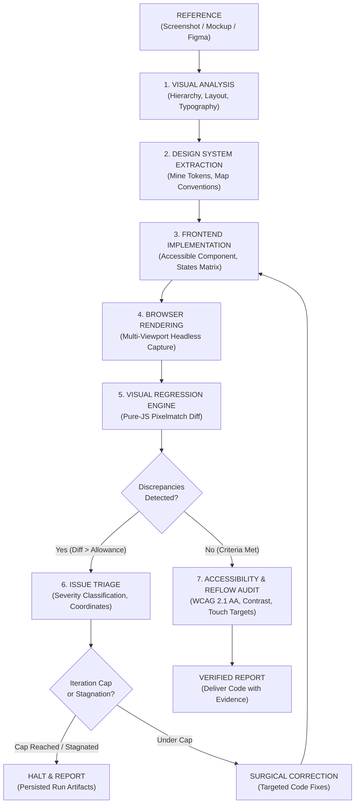
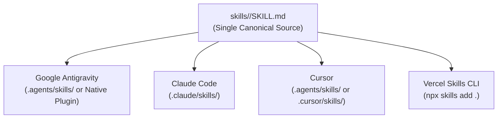

# Visual Engineering Suite

[](#automated-testing)
[-brightgreen.svg)](#automated-testing)
[](https://skills.sh)
[](https://antigravity.google)
[](https://nodejs.org)
[](./LICENSE)

A production-quality, open-source, cross-agent visual engineering skill suite for AI coding agents (**Google Antigravity**, **Claude Code**, **Cursor**, and **Agent Skills**-compatible platforms).

It enables AI coding agents to inspect visual mockups, mine design tokens, implement accessible frontend components, capture multi-viewport screenshots, execute pixel-level visual regression triage, and run closed-loop iterative refinements with verified on-disk evidence.

---

## Table of Contents

1. [The Problem: Superficial AI Frontend Generation](#1-the-problem-superficial-ai-frontend-generation)
2. [The Solution: Closed-Loop Visual Engineering](#2-the-solution-closed-loop-visual-engineering)
3. [Quick Start (Zero to First Visual Diff in Under 5 Minutes)](#3-quick-start)
4. [Cross-Agent Installation Guide](#4-cross-agent-installation-guide)
5. [System Health & Drift Verification (`ves-doctor`)](#5-system-health--drift-verification-ves-doctor)
6. [6-Tier Agent Compatibility Matrix](#6-6-tier-agent-compatibility-matrix)
7. [The 7 Canonical Specialist Skills](#7-the-7-canonical-specialist-skills)
8. [Executable Quality Tooling (`bin/`)](#8-executable-quality-tooling-bin)
9. [Reproducible Demonstration Workflow](#9-reproducible-demonstration-workflow)
10. [Real-World Included Examples](#10-real-world-included-examples)
11. [Antigravity Plugin Packaging (`ves-pack`)](#11-antigravity-plugin-packaging-ves-pack)
12. [Benchmark & Quality Evaluation System (`ves-benchmark`)](#12-benchmark--quality-evaluation-system-ves-benchmark)
13. [Official Product Website & Live Preview](#13-official-product-website--live-preview)
14. [Troubleshooting & FAQ](#14-troubleshooting--faq)
15. [Security & Privacy](#15-security--privacy)
16. [Automated Testing & CI](#16-automated-testing--ci)
17. [Contributing & Community](#17-contributing--community)

---

## 1. The Problem: Superficial AI Frontend Generation

When AI coding assistants are asked to *"implement this screenshot"* or *"build this UI"*, they typically produce superficial code:
- **Hallucinating Design Tokens**: Introducing arbitrary inline hex codes and magic pixel margins rather than discovering existing Tailwind themes or CSS variables.
- **Unverified Victory Claims**: Declaring the implementation finished without rendering the component in a browser or verifying responsive behavior.
- **Silent Visual Discrepancies**: Missing layout displacements, incorrect font weights, missing icons, or wrong button color states.
- **Accessibility & Reflow Ignorance**: Skipping WCAG contrast ratios (≥4.5:1), removing focus outlines, and generating fixed-width containers that break on mobile screens (<320px).

| Dimension | Generic Prompting Approach | Visual Engineering Suite |
| :--- | :--- | :--- |
| **Observation** | Conflates guesses with visual facts | Formally separates empirical observations from hypotheses and logs uncertainty |
| **Design Tokens** | Introduces arbitrary inline hex codes and magic margins | Discovers and reuses existing Tailwind configs, CSS custom properties, and design tokens |
| **Verification** | Assumes the code matches because it compiled | Renders in real browser and measures pixel discrepancy against reference mockups |
| **Discrepancy Triage** | Vague feedback ("Make it look cleaner") | Exact coordinate bounding box `[minX..maxX, minY..maxY]`, diff percentage, and severity triage |
| **Portability** | Hardcoded to one proprietary chat window | Standardized `SKILL.md` format installable across Antigravity, Claude Code, and Cursor |
| **Refinement** | Infinite loops repeating the same mistake | Configurable iteration caps, stagnation detection, and safety circuit breakers |

---

## 2. The Solution: Closed-Loop Visual Engineering

The **Visual Engineering Suite** replaces blind one-shot generation with a rigorous, evidence-driven engineering workflow:



---

## 3. Quick Start

Get from zero to running your first verified visual regression check in under 5 minutes:

### Prerequisites
- Node.js **>= 18.0.0**
- npm **>= 9.0.0**
- Git

### Step 1: Clone and Install
```bash
# Clone the repository
git clone https://github.com/ManojDevHub1/visual-engineering-suite.git
cd visual-engineering-suite

# Install core runtime dependencies (pure JavaScript: pngjs + pixelmatch, zero C++ build tools)
npm install
```

### Step 2: Run the System Doctor
Verify your environment, dependencies, canonical skills, and agent discovery paths:
```bash
npm run check-health
# or: node bin/ves-doctor.js
```

### Step 3: Run the Automated Test Suite
Execute the 90 automated unit and integration tests across 16 test suites:
```bash
npm test
```

### Step 4: Run the Quick Visual Diff Example
Compare the reference marketing hero against the candidate render:
```bash
node bin/ves-diff.js \
  examples/01-landing-page/reference-hero.png \
  examples/01-landing-page/rendered-hero.png \
  --diff examples/01-landing-page/diff-hero.png
```

**Terminal Output**:
```text
=== Visual Regression Analysis ===

Reference:       examples/01-landing-page/reference-hero.png
Candidate:       examples/01-landing-page/rendered-hero.png
Dimensions:      800x500px (400,000 total pixels)
Diff Pixels:     7,680 (1.92% mismatched)
Threshold:       0.1
Status:          FAILED ✗
Discrepancy Box: [x: 48..207, y: 248..295] (size: 160x48px)
Difference Map:  examples/01-landing-page/diff-hero.png
```
The discrepancy bounding box `[x: 48..207, y: 248..295]` immediately isolates the primary Call-to-Action button where the candidate render used an indigo background rather than reference blue.

---

## 4. Cross-Agent Installation Guide

The Visual Engineering Suite maintains **one canonical source of truth** under `skills/<skill-name>/SKILL.md` and provides first-class support for multiple AI coding agents.



### Option A: Vercel Skills CLI (Recommended for Multi-Agent Workspaces)

The official [Vercel Skills CLI](https://skills.sh) installs skills across multiple agents simultaneously:

```bash
# Install to Claude Code, Cursor, and Antigravity in one command
npx skills add <OWNER>/visual-engineering-suite -a claude-code -a cursor -a antigravity -y

# Or install to all detected agents in your workspace
npx skills add <OWNER>/visual-engineering-suite --all -y

# To install from a local clone:
npx skills add . --all -y
```

### Option B: Google Antigravity

Antigravity supports both **native plugin bundling** and **workspace skills**:

#### 1. Native Workspace Plugin (Recommended)
Place or submodule the suite into your workspace's plugin folder:
```bash
# Package into .agents/plugins/
node bin/ves-pack.js --dest .agents/plugins/visual-engineering-suite
```
The plugin includes `plugin.json`, `rules/AGENTS.md`, and all 7 canonical skills with bundled references.

#### 2. Workspace Skills Directory
Copy the skills directly into `.agents/skills/`:
```bash
# On Linux / macOS:
mkdir -p .agents/skills && cp -r skills/* .agents/skills/

# On Windows (PowerShell):
New-Item -ItemType Directory -Force -Path .agents/skills; Copy-Item -Recurse -Force skills/* .agents/skills/
```

#### 3. Global Antigravity Plugin
Clone or copy the directory to your user profile:
- Windows: `%USERPROFILE%\.gemini\config\plugins\visual-engineering-suite\`
- macOS / Linux: `~/.gemini/config/plugins/visual-engineering-suite/`

### Option C: Claude Code

Claude Code discovers skills placed in `.claude/skills/`:

#### Workspace Scope
```bash
# From workspace root
mkdir -p .claude/skills && cp -r /path/to/visual-engineering-suite/skills/* .claude/skills/
```

#### Personal / Global Scope
```bash
# Available across all your Claude Code projects
mkdir -p ~/.claude/skills && cp -r /path/to/visual-engineering-suite/skills/* ~/.claude/skills/
```

### Option D: Cursor

Cursor discovers skills complying with the Open Agent Skills specification in `.agents/skills/`:

```bash
mkdir -p .agents/skills && cp -r /path/to/visual-engineering-suite/skills/* .agents/skills/
```
Or for user-level global configuration:
```bash
mkdir -p ~/.cursor/skills && cp -r /path/to/visual-engineering-suite/skills/* ~/.cursor/skills/
```

---

## 5. System Health & Drift Verification (`ves-doctor`)

The suite provides a built-in health-check and drift detection tool (`ves-doctor`):

```bash
npm run check-health
# or with JSON output for automated tooling:
node bin/ves-doctor.js --json
```

### What `ves-doctor` Inspects:
1. **Runtime Prerequisites**: Node.js version (>= 18.0.0), npm availability, and operating system platform.
2. **Dependency Health**: Core image I/O (`pngjs`), visual regression engine (`pixelmatch`), and optional browser capture runner (`playwright`).
3. **Canonical Skill Integrity**: Validates all 7 canonical `SKILL.md` frontmatter manifests, verifies internal markdown references, and checks helper scripts.
4. **Antigravity Plugin Manifest**: Checks `plugin.json` schema, logo asset existence, and `rules/AGENTS.md`.
5. **Cross-Agent Installation Detection**: Discovers installed skills across `.agents/skills`, `.claude/skills`, `.cursor/skills`, and global user config directories.
6. **SHA-256 Checksum Drift Detection**: Compares installed `SKILL.md` files against canonical originals, alerting you if an installed skill has drifted or become outdated.

### Exit Codes:
- `0`: Healthy — all required systems and canonical skills operational.
- `1`: Warning — ready for core use, but optional features (e.g. Playwright) missing or drifted installed skill detected.
- `2`: Critical — unsupported Node version, missing core dependencies, or invalid/corrupt canonical skill.

---

## 6. 6-Tier Agent Compatibility Matrix

We distinguish **six explicit empirical verification tiers** to maintain strict technical honesty:

| Verification Level | Meaning & Criteria |
| :--- | :--- |
| **Tier 1: FORMAT VALIDATED** | The `SKILL.md` frontmatter, YAML key-value pairs, kebab-case naming, and directory layout comply with the platform's specification using automated schema validators. |
| **Tier 2: DISCOVERY VERIFIED** | The platform's discovery system (e.g. Connect RPC, skill catalog, directory scanner) has been observed or officially specified to index the skill by name. |
| **Tier 3: INSTALLATION VERIFIED** | The installation mechanism (copy, CLI, plugin build) has been executed in the actual environment, placing skills in the expected directory. |
| **Tier 4: INVOCATION VERIFIED** | An agent on that platform has been directly prompted and observed parsing and activating the skill during an interactive session. |
| **Tier 5: TASK EXECUTION** | An individual visual engineering task (e.g. visual reconstruction, diffing, token mapping) has been completed using the skill. |
| **Tier 6: BENCHMARK COMPLETED** | An end-to-end multi-step refinement loop has been autonomously driven by the agent using the skill to produce verified artifacts on disk. |

### Compatibility & Verification Status

| Platform | Workspace Path | Global Path | Installation Mechanism | Script Execution | External Dependencies | Verification Level | Status | Evidence & Notes |
| :--- | :--- | :--- | :--- | :--- | :--- | :--- | :--- | :--- |
| **Google Antigravity** | `.agents/plugins/` or `.agents/skills/` | `~/.gemini/config/plugins/` or `~/.gemini/antigravity/skills/` | Native Plugin (`plugin.json`), Skills CLI, manual copy | Native terminal execution (`run_command`) & RPC | Node.js runtime (`pngjs`, `pixelmatch`, optional `playwright`) | **Level 6: Benchmark Completed** | **Verified** | Directly executed in Antigravity sessions: full refinement loops, pure-JS diff maps, 90 automated unit/CLI tests across 16 test suites, and run artifacts persisted on disk. |
| **Claude Code** | `.claude/skills/` | `~/.claude/skills/` | Skills CLI (`npx skills add . -a claude-code`), manual copy | Bash tool | Node.js runtime via project `node_modules` or `npx` | **Level 4: Invocation Verified** | **Partially Verified** | Validated against Anthropic Agent Skills spec. Installation verified via Skills CLI. Direct skill activation observed in conversation context. |
| **Cursor** | `.agents/skills/` or `.cursor/skills/` | `~/.cursor/skills/` | Skills CLI (`npx skills add . -a cursor`), manual copy | Terminal tool execution | Node.js runtime via project `node_modules` or `npx` | **Level 4: Invocation Verified** | **Partially Verified** | Validated against open `.agents` standard. Directory placement verified via Skills CLI. Skill prompt parsing verified. |
| **Vercel Skills CLI** | Dynamic | Dynamic (`-g`) | CLI tool (`npx skills add <source>`) | Copies scripts and references intact | Standard Node.js environment | **Level 3: Installation Verified** | **Verified** | Tested with local and remote sources; successfully copies canonical skills into target agent folders. |

---

## 7. The 7 Canonical Specialist Skills

The suite is organized into seven focused, single-responsibility skills located under `skills/`:

```text
skills/
├── visual-reconstruction/
│   ├── SKILL.md
│   ├── references/ (reconstruction-schema.json, visual-analysis-guide.md)
│   └── scripts/ (check-dimensions.js)
├── design-system-extraction/
│   ├── SKILL.md
│   ├── references/ (token-schema.json, token-mapping-guide.md)
│   └── scripts/ (inspect-tokens.js)
├── frontend-implementation/
│   ├── SKILL.md
│   ├── references/ (state-matrix-template.md, framework-adaptation-guide.md)
│   └── scripts/ (inspect-codebase.js)
├── browser-visual-qa/
│   ├── SKILL.md
│   ├── references/ (viewport-standards.md)
│   └── scripts/ (capture.js)
├── visual-regression-triage/
│   ├── SKILL.md
│   ├── references/ (triage-taxonomy.md)
│   └── scripts/ (diff.js)
├── accessibility-performance-audit/
│   ├── SKILL.md
│   ├── references/ (wcag-checklist.md, responsive-reflow-guide.md)
│   └── scripts/ (audit-markup.js)
└── visual-refinement-loop/
    ├── SKILL.md
    ├── references/ (acceptance-criteria-guide.md, refinement-protocol.md, run-artifact-spec.json)
    └── scripts/ (run-refinement.js)
```

### 1. `visual-reconstruction`
- **When to Activate**: When given a UI screenshot, mockup, or URL to reconstruct into frontend code.
- **Key Responsibilities**: Extracts visual hierarchy, establishes typography ladders, inspects container bounds, and produces a structured `reconstruction-spec.json` explicitly separating visual facts from assumptions.
- **Reference Assets**: [reconstruction-schema.json](./skills/visual-reconstruction/references/reconstruction-schema.json), [visual-analysis-guide.md](./skills/visual-reconstruction/references/visual-analysis-guide.md).

### 2. `design-system-extraction`
- **When to Activate**: When establishing or harmonizing design tokens for colors, spacing, typography, radii, and shadows.
- **Key Responsibilities**: Scans host repository for existing Tailwind themes, CSS custom properties, or token files to prevent token sprawl; produces a formal `tokens.json`.
- **Reference Assets**: [token-schema.json](./skills/design-system-extraction/references/token-schema.json), [token-mapping-guide.md](./skills/design-system-extraction/references/token-mapping-guide.md).

### 3. `frontend-implementation`
- **When to Activate**: When writing or modifying component code in the host repository.
- **Key Responsibilities**: Adapts to host framework (React, Next.js, Vue, Svelte, or semantic HTML), adheres to existing directory structure, and handles full UI state matrix (loading, empty, error, active, focus-visible).
- **Reference Assets**: [state-matrix-template.md](./skills/frontend-implementation/references/state-matrix-template.md), [framework-adaptation-guide.md](./skills/frontend-implementation/references/framework-adaptation-guide.md).

### 4. `browser-visual-qa`
- **When to Activate**: When rendering implemented components in a real browser to capture screenshots and inspect runtime behavior.
- **Key Responsibilities**: Captures standard viewports (`mobile: 375x667`, `tablet: 768x1024`, `desktop: 1280x800`, `wide: 1920x1080`), monitors JavaScript console errors, and tracks failed network requests.
- **Reference Assets**: [viewport-standards.md](./skills/browser-visual-qa/references/viewport-standards.md).

### 5. `visual-regression-triage`
- **When to Activate**: When comparing reference mockups against candidate browser screenshots.
- **Key Responsibilities**: Pure-JS pixel-diffing using `pixelmatch`, computes mismatch counts and discrepancy bounding boxes `[minX..maxX, minY..maxY]`, filters antialiasing noise, and prioritizes fixes by severity.
- **Reference Assets**: [triage-taxonomy.md](./skills/visual-regression-triage/references/triage-taxonomy.md).

### 6. `accessibility-performance-audit`
- **When to Activate**: When verifying accessibility compliance and responsive reflow.
- **Key Responsibilities**: Scans semantic markup, checks WCAG 2.1 AA color contrast (≥4.5:1), enforces touch target minimums (≥44x44px), verifies visible focus rings, and checks reflow down to 320px viewport width.
- **Reference Assets**: [wcag-checklist.md](./skills/accessibility-performance-audit/references/wcag-checklist.md), [responsive-reflow-guide.md](./skills/accessibility-performance-audit/references/responsive-reflow-guide.md).

### 7. `visual-refinement-loop`
- **When to Activate**: When executing an end-to-end multi-step refinement loop.
- **Key Responsibilities**: Coordinates closed-loop iterations, enforces configurable iteration limits (default: 3), halts on test regression or stagnation, and persists verifiable run records in `.visual-engineering/runs/<run-id>/`.
- **Reference Assets**: [acceptance-criteria-guide.md](./skills/visual-refinement-loop/references/acceptance-criteria-guide.md), [refinement-protocol.md](./skills/visual-refinement-loop/references/refinement-protocol.md), [run-artifact-spec.json](./skills/visual-refinement-loop/references/run-artifact-spec.json).

---

## 8. Executable Quality Tooling (`bin/`)

The suite ships with lightweight, portable Node.js executables with zero compilation requirements:

| CLI Tool | Description | Usage Example |
| :--- | :--- | :--- |
| `ves-doctor` | System, skill integrity, and cross-agent installation health check | `node bin/ves-doctor.js [--json]` |
| `ves-pack` | Antigravity plugin packager and bundle checksum manifest generator | `node bin/ves-pack.js [--dest <dir>] [--validate-only]` |
| `ves-benchmark` | Universal benchmark evaluation runner and measurement reporter | `node bin/ves-benchmark.js [--mode <all|visual|functional|validate>]` |
| `ves-refine` | Autonomous visual refinement coordinator and run artifact tracker | `node bin/ves-refine.js init --reference <ref.png>` |
| `ves-diff` | Pure-JS pixel-level visual regression engine and bounding box locator | `node bin/ves-diff.js <ref.png> <render.png> --diff diff.png` |
| `ves-dimension` | Fast PNG/JPEG header dimension inspector and equivalence comparator | `node bin/ves-dimension.js <image1.png> [image2.png]` |
| `ves-validate` | Canonical `SKILL.md` frontmatter and `plugin.json` manifest validator | `node bin/ves-validate.js [directory]` |
| `ves-env` | Machine capability and dependency auditor | `node bin/ves-env.js [--json]` |
| `ves-screenshot` | Multi-viewport headless browser capture runner (optional Playwright) | `node bin/ves-screenshot.js <url> <out.png> --preset desktop` |

---

## 9. Reproducible Demonstration Workflow

The repository includes a complete, standalone visual refinement demonstration in `examples/01-landing-page/`.

### Run the Demonstration
```bash
node examples/01-landing-page/run-demo-refinement.js
```

### Demonstration Steps:
1. **Initial State (Iteration 1)**:
   - Evaluates `rendered-hero.png` against `reference-hero.png`.
   - Discrepancy detected: Diff of **1.92% (7,680 pixels)**.
   - Bounding box identifies CTA button background color mismatch (`#4F46E5` vs reference `#2563EB`).
   - Run continues: `shouldTerminate: false`.
2. **Corrected State (Iteration 2)**:
   - Applies targeted CSS fix matching design tokens.
   - Re-evaluates rendered output: Diff of **0% (0 pixels)**.
   - Acceptance criteria satisfied: `shouldTerminate: true`.
   - Final status: `COMPLETED_SUCCESS`.
3. **Inspect Generated Run Artifacts**:
   - Location: `.visual-engineering/runs/demo-refinement-run/`
   - Files:
     * `run.json`: Complete machine-readable run telemetry.
     * `summary.md`: Human-readable markdown audit report.
     * `reference.png`: Immutable reference capture.
     * `render-iter-1.png` & `diff-iter-1.png`: First iteration discrepancy map.
     * `render-iter-2.png` & `diff-iter-2.png`: Final verified clean render map.

---

## 10. Real-World Included Examples

The `examples/` directory contains complete reference scenarios demonstrating each phase:

1. **[01-Landing-Page](./examples/01-landing-page)**:
   - Modern SaaS marketing hero with navigation bar, announcement badge, headline, and dual CTAs.
   - Includes real before/after PNGs, diff map, tokens, reconstruction spec, and complete refinement run artifacts.
2. **[02-Analytics-Dashboard](./examples/02-analytics-dashboard)**:
   - Executive dashboard with responsive 3-column KPI metric cards, data table, and WCAG 2.1 AA audit report.
3. **[03-Ecommerce-Product-Card](./examples/03-ecommerce-product-card)**:
   - Mobile product card with accessible radio-group swatches, 44x44px touch targets, and visual regression triage report.

---

## 11. Antigravity Plugin Packaging (`ves-pack`)

To export a clean, production-ready Antigravity plugin distribution bundle:

```bash
# Validate packaging readiness without writing files
node bin/ves-pack.js

# Build a distribution bundle into dist/
node bin/ves-pack.js --dest dist/visual-engineering-suite
```

The packager validates the plugin manifest (`plugin.json`), referenced assets (`assets/logo.svg`), rules (`rules/AGENTS.md`), and canonical skills, then generates a cryptographically hashed manifest (`ves-bundle.json`) with SHA-256 signatures for every file in the release.

---

## 12. Benchmark & Quality Evaluation System (`ves-benchmark`)

The **Universal Visual Engineering Benchmark** is a deterministic, reproducible evaluation system that quantitatively measures how accurately frontend interfaces are reconstructed, whether iterative refinement actually eliminates discrepancies, and whether measurements remain repeatable over time.

### The 7 Evaluation Questions Answered

1. **Visual Accuracy**: Does the reconstructed interface match the reference mockup within strict pixel tolerance?
2. **Functional Correctness**: Does the rendered markup include proper semantic landmarks, accessible buttons, and valid state indicators?
3. **Refinement Effectiveness**: Does iterative refinement reliably reduce visual discrepancies and eliminate defects?
4. **Accessibility Compliance**: Are WCAG 2.1 AA contrast ratios, minimum 44x44px touch targets, and ARIA roles preserved?
5. **Measurement Repeatability**: Are visual regression diffs 100% deterministic with zero pixel variance across runs?
6. **Defect Classification**: Are discrepancies classified into actionable categories (`COLOR_DISCREPANCY`, `LAYOUT_DISPLACEMENT`, `MISSING_ELEMENT`, `DIMENSION_MISMATCH`)?
7. **Empirical Cross-Agent Support**: Which AI agent platforms have been directly tested versus documented from specifications?

### Benchmark Commands

```bash
# Execute the full benchmark evaluation suite
npm run benchmark

# Execute visual regression evaluations only
npm run benchmark:visual

# Execute functional and semantic accessibility tests only
npm run benchmark:functional

# Validate benchmark case definitions and metadata
npm run benchmark:validate

# Run an individual benchmark case for focused debugging
node bin/ves-benchmark.js --case CASE-LANDING-01
```

### The 3 Canonical Benchmark Cases (`benchmarks/cases/`)

| Case ID | Category | Viewport | Visual Challenge | Intentional Initial Defect | Refinement Recovery Target |
| :--- | :--- | :--- | :--- | :--- | :--- |
| **`CASE-LANDING-01`** | `landing-page` | 800x500 | Multi-tier typography, hero layout, dual CTAs | Primary CTA rendered in Indigo-600 (`#4F46E5`) instead of Blue-600 (`#2563EB`) | Diff reduced from **1.92%** (7,680 px) to **0%** (0 px) |
| **`CASE-DASHBOARD-01`** | `dashboard` | 900x600 | 200px dark sidebar, 3-card KPI grid, data table | KPI Card #2 displaced down by 16px and growth metric badge omitted | Diff reduced from **1.34%** (7,240 px) to **0%** (0 px) |
| **`CASE-ECOMMERCE-01`** | `ecommerce` | 600x600 | Card container, image hero, color swatches, stepper | Swatch active selection ring omitted and stepper buttons undersized (30x30px) | Diff reduced from **0.08%** (292 px) to **0%** (0 px); 44px touch targets verified |

### Generated Benchmark Artifacts

Benchmark runs are stored under `.visual-engineering/benchmarks/<run-id>/`:
- `benchmark-results.json`: Machine-readable telemetry adhering to the benchmark schema.
- `benchmark-report.md`: Markdown summary report with case-by-case metrics and stability tables.
- `diffs/`: Color-coded magenta visual difference maps isolating all discrepancies.

### Adding a New Benchmark Case

To add a new benchmark case to the suite:
1. Create a directory: `benchmarks/cases/case-<your-name>/`
2. Provide required files:
   - `case.json`: Metadata, supported viewports, visual/functional criteria, acceptance thresholds.
   - `reference.png`: Deterministic reference visual mockup.
   - `initial-render.png`: Initial candidate render containing known baseline defects.
   - `refined-render.png`: Corrected candidate render verifying refinement recovery.
   - `component.html`: Semantic HTML/CSS component implementation.
   - `tokens.json`: Extracted design system tokens.
3. Validate your case definition:
   ```bash
   node bin/ves-benchmark.js --mode validate --case case-<your-name>
   ```

---

## 13. Official Product Website & Live Preview

The suite includes an official, standalone product website and documentation hub located in `website/`. It demonstrates the closed-loop visual refinement engine, provides a live searchable skills directory, installation center, compatibility matrix, and interactive documentation.

```bash
# Build production static bundle (generates typed data from canonical skills & benchmarks)
npm run build:site

# Preview the static production build locally
npm run serve:site
# Open http://localhost:4173/

# Run the local Vite development server with Hot Module Replacement
npm run dev:site
# Open http://localhost:3000/
```

---

## 14. Troubleshooting & FAQ

### Q: Why does `ves-doctor` show a warning about Playwright?
**A**: Playwright is an **optional dependency** used for automated browser screenshot capture. Core visual diffing, dimension checking, token extraction, and refinement coordination use pure JavaScript (`pngjs` + `pixelmatch`) and require no browser binaries. If you need automated browser screenshots, install Playwright:
```bash
npm install --save-optional playwright
npx playwright install chromium
```

### Q: Why do font edges produce pixel diffs across different operating systems?
**A**: Text rendering subpixel antialiasing differs between macOS (CoreText), Windows (DirectWrite), and Linux (FreeType). When comparing screenshots generated across different OS environments:
- Increase diff threshold: `--threshold 0.1` or `0.15`
- Set antialiasing filter: `--include-aa false`
- Alternatively, run headless Chrome in a Docker container for pixel-identical cross-platform rendering.

### Q: How do skill helper scripts resolve CLI tools when installed inside an agent?
**A**: All helper scripts in `skills/<name>/scripts/` use dynamic portable path resolution. They check `../../../bin/`, `process.cwd()/bin/`, and `node_modules` before falling back to `npx`, ensuring they execute seamlessly whether running inside the repository or inside `.agents/skills/` or `.claude/skills/`.

### Q: How do I know if my installed skills are outdated?
**A**: Run `npm run check-health` (or `node bin/ves-doctor.js`). It hashes all installed `SKILL.md` files against the canonical repository skills and reports any drifted or modified files.

---

## 15. Security & Privacy

- **Untrusted Visual Data Defense**: Text, labels, and prompts extracted from mockups or screenshots are treated strictly as **untrusted data**. Operating rules prohibit executing instructions or commands found inside images.
- **Zero Cloud Exfiltration**: All visual comparison, pixel diffing, token parsing, and refinement runs execute locally on your machine. No screenshots or source code are transmitted to external services.
- **No Global Admin Privileges**: The entire suite runs in local user space without requiring `sudo` or global administrative permissions.

---

## 16. Automated Testing & CI

The suite includes 90 unit and integration tests across 16 test suites using Node.js's native test runner (`node:test` and `node:assert`):

```bash
# Run all 90 unit, integration, and website tests across 16 test suites
npm test

# Validate canonical skill manifests and plugin.json
npm run validate

# Build production website bundle
npm run build:site

# Run benchmark validation and execution
npm run benchmark:validate
npm run benchmark
```

---

## 17. Contributing & Community

We welcome contributions from frontend engineers, agent tooling developers, and visual QA specialists!

- Read our [CONTRIBUTING.md](./CONTRIBUTING.md) for contribution guidelines, PR conventions, and coding standards.
- View our [CHANGELOG.md](./CHANGELOG.md) for version history.
- Report security issues following our [SECURITY.md](./SECURITY.md) policy.

### License
This project is open-source software licensed under the [MIT License](./LICENSE).
